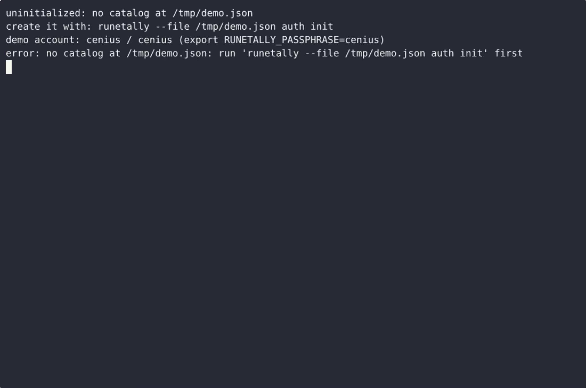
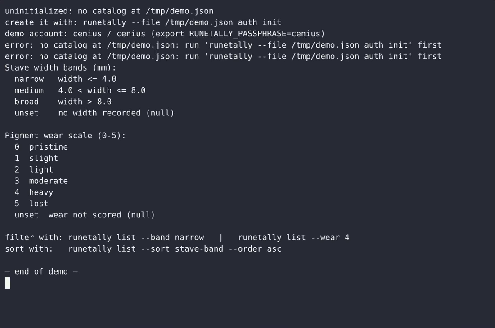

# RuneTally2 — complete Full-stack app command-line tool example app

If you want a self-hosted command-line tool without the vendor lock-in, **RuneTally2** is ready to run. Built with Full-stack app and Apache-2.0-licensed, RuneTally2 ships complete — one clone, one install command. RuneTally2 is a single-file, standard-library-only Python CLI that keeps a runic inscription catalog in a JSON file beside the script: add one inscription at a time from flags or interactive prompts, browse and filter…. [Open RuneTally2 on cenius.ai](https://cenius.ai/marketplace/p/runetally2?ref=gh&utm_campaign=runetally2-webapp) to customise it without touching a line of RuneTally2 code.


[](LICENSE)  [](https://cenius.ai)

[](https://cenius.ai/marketplace/p/runetally2?ref=gh&utm_campaign=runetally2-webapp)

> **▶ [Open & edit in cenius.ai](https://cenius.ai/marketplace/p/runetally2?ref=gh&utm_campaign=runetally2-webapp)** — one click to an editable workspace: describe changes in plain English, get an instant preview, one-click deploy and host. Modifications made on the platform come with full rebrand & relicense rights.

_Local clone? See [Quick start](#quick-start) below. cenius.ai is the zero-setup path._

## Demo


📽 **[Demo video on cenius.ai](https://cenius.ai/marketplace/p/runetally2?ref=gh&utm_campaign=runetally2-webapp)** — the complete run-through · [MP4](.github/media/demo.mp4)

## Screenshots

 

## Features

- Persistent local catalog file
- Add an inscription from the CLI
- Browse the catalog: table and detail view
- Stave width sorting with band labels
- Pigment wear scoring
- Import inscriptions from JSON or CSV
- Self-documenting command surface
- Delete an inscription

## Quick start

```bash
./install.sh   # installs dependencies + seeds demo data
```

See [`INSTALL.md`](INSTALL.md) for full setup and usage instructions.

## Usage guide

### Overview

Catalog runic inscriptions, sort by stave width, score pigment wear (standard library only).

### Quickstart

```bash
runetally --help
## or, if installed from source without symlink:
python -m runetally2 --help
```

### Commands

This CLI exposes **10** subcommands. Each was extracted from the source.

| Command | Source file |
|---------|-------------|
| `runetally add` | `runetally.py` |
| `runetally auth` | `runetally.py` |
| `runetally bands` | `runetally.py` |
| `runetally delete` | `runetally.py` |
| `runetally edit` | `runetally.py` |
| `runetally import` | `runetally.py` |
| `runetally init` | `runetally.py` |
| `runetally list` | `runetally.py` |
| `runetally show` | `runetally.py` |
| `runetally status` | `runetally.py` |

#### Per-command help

```bash
runetally --help                # top-level help
runetally add --help    # help for `add`
```

### Worked example

1. Verify the CLI is on your PATH: `which runetally` (or run via `cargo run --`/`python -m`).
2. Show all subcommands: `runetally --help`.
3. Try the first detected subcommand:

```bash
runetally add --help
```

### Reference

#### Entry points

| Kind | Name | Source |
|------|------|--------|
| Console script | `runetally` | `runetally:main` (pyproject.toml) |

#### Surface index (auto-extracted)

_Full guide: [`USAGE.md`](USAGE.md)_

## Architecture

Full-stack app project, delivered as a complete runnable codebase (27 files). Top-level layout: `examples/`, `tests/`. The setup script (`install.sh`) installs runtime dependencies and loads a starter dataset so the app is immediately usable. See [`INSTALL.md`](INSTALL.md) for complete setup instructions.

## FAQ

### Can I deploy RuneTally2 on my own infrastructure?

Everything you need ships in this repo: clone it, run `./install.sh` to install dependencies and seed demo data, then follow [`INSTALL.md`](INSTALL.md) to start it. No external services required.

### How do I make RuneTally2 my own brand?

Absolutely. [Open it on cenius.ai](https://cenius.ai/marketplace/p/runetally2?ref=gh&utm_campaign=runetally2-webapp) and remix it there — platform modifications come with full rebrand and relicense rights over your derivative, so the result is entirely yours.

### Can non-developers customise RuneTally2?

Non-developers can use [cenius.ai](https://cenius.ai/marketplace/p/runetally2?ref=gh&utm_campaign=runetally2-webapp) to make changes. Describe your goal in everyday language and the platform delivers an updated, ready-to-run project — zero coding on your part.

### Which technology stack does RuneTally2 use?

RuneTally2 runs on Full-stack app. This repo holds the full production source: you can inspect every part of it before deploying. Highlights include persistent local catalog file.

### Can I use RuneTally2 in a commercial project?

It is. Apache-2.0 licensing means you can build a product on it, sell it, or use it inside a company with no fees. Details: [LICENSE](LICENSE).

## License & rebranding

Released under the [Apache License 2.0](LICENSE) (© 2026 Cenius AI) — free for personal and commercial use. The Cenius name/logo are trademarks (see NOTICE).

**Need a customized version?** [Remix this app on cenius.ai](https://cenius.ai/marketplace/p/runetally2?ref=gh&utm_campaign=runetally2-webapp) — modifications made on the platform come with **full rebrand & relicense rights** over your derivative.

## Built with cenius.ai

This entire application — code, design, seeded demo data — was generated on **[cenius.ai](https://cenius.ai)** from a plain-English description.

- 🚀 [Build your own app on cenius.ai](https://cenius.ai)
- 🎛️ [Remix RuneTally2 on the marketplace](https://cenius.ai/marketplace/p/runetally2?ref=gh&utm_campaign=runetally2-webapp) — open it in a workspace, prompt for changes, and ship your own version.

More open-source apps: [the Cenius-ai catalog](https://github.com/Cenius-ai) · [showcase index](https://github.com/Cenius-ai/showcase)
